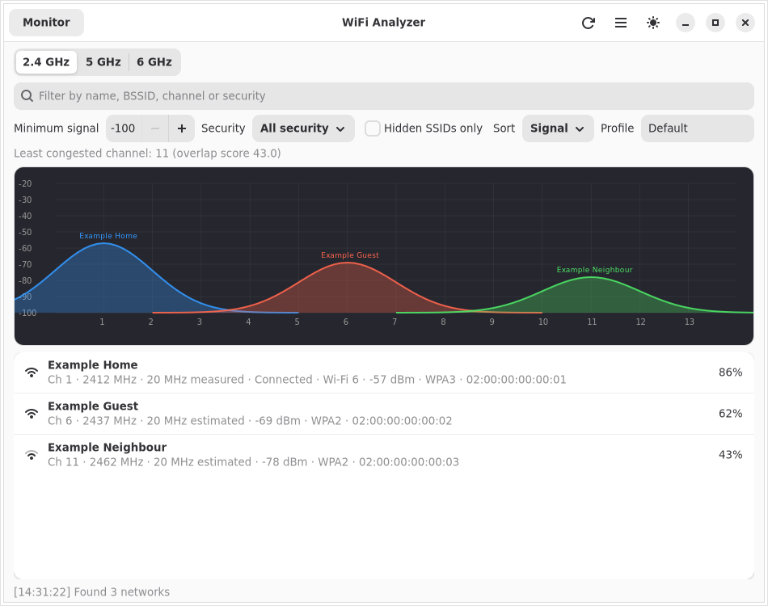
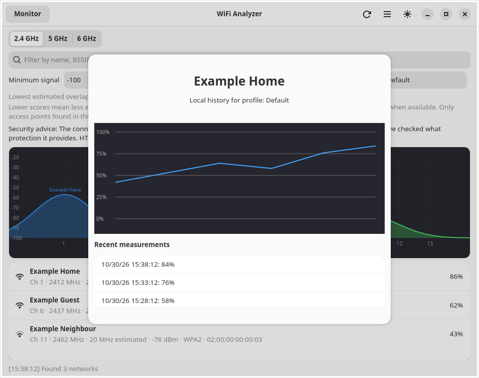

<p align="center">
  
</p>

# WiFi Analyzer

Wi-Fi signal analyzer, channel planner and local connection diagnostics tool.

Built with GTK4/Adwaita. Part of the [Danne L10n Suite](https://github.com/yeager/debian-repo).



*Example networks shown; the app displays scan results from the local device.*



*Fictional local measurements shown; the text list complements the chart for screen-reader users.*

## Features

- Scan access points through NetworkManager D-Bus; no privileged shell command is required.
- Prefer the adapter with an active NetworkManager connection when the computer has multiple Wi-Fi devices. Active-link width and Wi-Fi generation are read from that interface.
- Filter results by network name, BSSID, channel or security type.
- Inspect 2.4, 5 and 6 GHz bands with a channel-overlap graph.
- Navigate the channel graph with Left/Right and Home/End, filter channels with Enter/Space, and hear channel selections read by screen readers.
- Show NetworkManager's announced AP bandwidth when available, with a clearly
  marked estimate as a fallback.
- Mark 5 GHz DFS channels. Their availability depends on the local regulatory domain.
- Estimate channel overlap from access points visible in a scan. The score does not measure client traffic or hidden networks.
- Exclude channels outside the locally reported regulatory ranges and channels marked `NO-IR`, passive-scan or no-beaconing from recommendations when that information is available.
- Sort results by signal, channel, or security and group repeated SSIDs by access-point count.
- Export visible, filtered results as CSV, JSON, anonymized JSON or an HTML
  diagnostic report, with a user-selected file name and destination.
- Escape formula-like untrusted text in CSV exports so nearby network names
  are not interpreted as spreadsheet formulas.
- Keep up to 100 local scan summaries for future history views. Scan data never leaves the device and can be cleared from the menu.
- Review local signal history with an accessible chart summary and a newest-first text list of measurements.
- Mark the active access point and use the actual channel width reported by `iw` for that radio when available.
- Identify Wi-Fi 4, 5, 6/6E and 7 for the active link from `iw` PHY markers.
  A generation is never guessed for an unconnected AP.
- Compare consecutive scans to identify new, missing, or materially changed access points.
- Create a self-contained HTML diagnostic report or an anonymized JSON export
  that omits SSIDs, BSSIDs and connection-specific fields. Radio measurements
  remain and can still reveal a location; review the file before sharing it.
- Select an access point to identify the strongest overlapping neighbours.
- Show the active connection's gateway and DNS servers from local system diagnostics.
- Use optional 60-second monitoring and location profiles for private local scan history.

## Installation

### PyPI (Debian/Ubuntu)

GTK, libadwaita, PyGObject and Pycairo use native system libraries, so install
them from your distribution before installing the Python package:

```bash
sudo apt install python3-gi python3-gi-cairo python3-cairo gir1.2-gtk-4.0 gir1.2-adw-1 network-manager iw pipx
pipx install --system-site-packages wifi-analyzer
```

### Debian/Ubuntu

`wifi-analyzer` is distributed through the [Danne L10n Suite APT repository](https://github.com/yeager/debian-repo), not the default Debian or Ubuntu repositories. Add the repository before installing:

```bash
wget -qO /tmp/yeager-repo-key.asc https://yeager.github.io/debian-repo/yeager-repo-key.asc
sudo install -m 0644 /tmp/yeager-repo-key.asc /usr/share/keyrings/yeager-repo.asc
echo 'deb [signed-by=/usr/share/keyrings/yeager-repo.asc] https://yeager.github.io/debian-repo ./' | sudo tee /etc/apt/sources.list.d/yeager.list
sudo apt update
sudo apt install wifi-analyzer
```

If APT still cannot find the package, check that the repository appears in
`apt update` and run `apt-cache policy wifi-analyzer`. The signed APT index may
lag behind the latest release. To install the current version, download the
`.deb` from [GitHub Releases](https://github.com/yeager/wifi-analyzer/releases/latest)
and install the downloaded file with `sudo apt install ./wifi-analyzer_*.deb`.

Source packages follow Debian policy and can be built with:

```bash
dpkg-buildpackage -us -uc -b
```

### Fedora/RPM distributions

The release includes an RPM built on Fedora 44. Download it from
[GitHub Releases](https://github.com/yeager/wifi-analyzer/releases/latest)
and install it on Fedora 44 with `sudo dnf install ./wifi-analyzer-*.rpm`.

Build the source RPM with:

```bash
rpmbuild -ba packaging/rpm/wifi-analyzer.spec
```

GitHub Actions builds both `.deb` and `.rpm` artifacts for releases and pull
requests.

## Translations

The user interface ships gettext catalogues for 21 locales. Swedish is
complete and reviewed; other catalogues may be partial, and untranslated
strings fall back to English.
See [`po/README.md`](po/README.md) to contribute or validate a translation.
The Swedish manual page is installed as `wifi-analyzer(1)` and is maintained in
[`docs/man/sv`](docs/man/sv).

### Flatpak

The Flatpak package is built from
[`flatpak/io.github.yeager.wifi-analyzer.json`](flatpak/io.github.yeager.wifi-analyzer.json).
GitHub Actions builds an installable `.flatpak` bundle for pull requests and
pushes to `main`. For a version release, the workflow creates a temporary
manifest pinned to that exact release tag and includes the bundle alongside the
DEB and RPM files on [GitHub Releases](https://github.com/yeager/wifi-analyzer/releases/latest).
Download the `.flatpak` file and install it like this:

```bash
flatpak remote-add --user --if-not-exists flathub \
  https://dl.flathub.org/repo/flathub.flatpakrepo
flatpak install --user ./io.github.yeager.wifi-analyzer.flatpak
```

## License

GPL-3.0

## Author

Daniel Nylander — [danielnylander.se](https://danielnylander.se)
